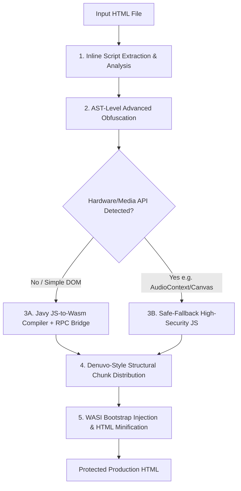

# 🛡️ Dontrea

[](https://opensource.org/licenses/MIT)
[](https://nodejs.org/)
[](https://github.com/Shopify/javy)
[](README.tr.md)

> **[🇹🇷 Türkçe Dokümantasyon için buraya tıklayın](README.tr.md)**

**Dontrea** is an enterprise-grade anti-piracy, code virtualization, and anti-reverse-engineering security pipeline designed with **Denuvo-inspired architecture**. It protects web applications, browser games, and client-side JavaScript by transforming scripts into WebAssembly bytecode, distributing fragmented payloads across hidden DOM elements, and locking execution with aggressive obfuscation and anti-tamper mechanisms.

---

## 📑 Table of Contents

- [Core Architecture](#-core-architecture)
- [How It Works](#-how-it-works)
- [Why Javy WebAssembly?](#-why-javy-webassembly)
- [Smart Dual-Mode Engine](#-smart-dual-mode-engine)
- [Prerequisites & Installation](#-prerequisites--installation)
- [CLI Usage & Options](#-cli-usage--options)
- [Examples](#-examples)
- [Security Layers Deep Dive](#-security-layers-deep-dive)
- [Troubleshooting & FAQ](#-troubleshooting--faq)
- [License](#-license)

---

## 🚀 Core Architecture

Dontrea operates through a **5-layer defense-in-depth pipeline**:



1. **Script Extraction & API Analysis:** Parses HTML, extracts all inline `<script>` blocks, and performs static analysis to evaluate compatibility with WebAssembly linear memory.
2. **Aggressive JS Obfuscation:** Transforms JavaScript using Control Flow Flattening, Dead Code Injection, String Array encoding with Base64/RC4 wrappers, and Anti-DevTools locks.
3. **JS-to-Wasm Compilation (Javy / QuickJS):** Compiles the obfuscated logic into WebAssembly bytecode via Javy, embedding a synchronous RPC bridge for transparent DOM and window proxying.
4. **Denuvo-Style Fragment Distribution:** Slices the binary/encrypted payload into configurable chunks and scatters them into dynamically generated HTML tags (`<div>`, `<span>`, `<section>`, etc.) with randomized IDs and `data-*` attributes styled with zero-footprint stealth CSS.
5. **Runtime WASI Bootstrap & Minification:** Embeds a self-defending bootstrap loader with an inlined `wasi_snapshot_preview1` runtime, followed by multi-pass structural HTML compression.

---

## 💡 Why Javy WebAssembly?

Earlier compilers (such as Porffor) were experimental, limited in scope, and incompatible with native Windows environments. Dontrea leverages **[Shopify Javy](https://github.com/Shopify/javy)** (powered by Fabrice Bellard's **QuickJS** engine):

| Feature | Experimental AOT (Porffor) | Javy (QuickJS Engine) |
| :--- | :--- | :--- |
| **Platform Support** | Linux / macOS / WSL only | **Cross-platform: Windows, macOS, Linux** |
| **Language Features** | Limited ES subset | **Full ECMAScript 2020+ (Classes, Proxies, Async/Await, BigInt)** |
| **Stability** | Prototype | **Production-grade (Shopify Core)** |
| **DOM / Window Bridge** | Stubbed / Broken | **Synchronous Bi-Directional RPC Bridge** |
| **Execution Sandbox** | Primitive memory | **Isolated Wasm Virtual Machine** |

---

## ⚡ Smart Dual-Mode Engine

WebAssembly runs inside an isolated linear memory sandbox without direct access to operating system sound cards or GPU rendering pipelines. Dontrea features an **intelligent detection engine**:

### 1. WebAssembly Mode (Default for Computational & Standard DOM Logic)
- Compiles your JavaScript into compact WebAssembly bytecode.
- Uses an inlined WASI preview-1 implementation for standard I/O (`console.log`, `console.error`) and high-resolution timing (`performance.now`).
- Transparent proxying enables DOM manipulation (`document.getElementById`, `.innerHTML`, `.style.*`, `.setAttribute`, etc.) from inside Wasm.

### 2. Safe-Fallback Mode (Automatic for Heavy Canvas & Audio Applications)
- When hardware-bound browser APIs are detected (such as `AudioContext`, `webkitAudioContext`, `canvas.getContext('2d')`, or `WebGLRenderingContext`), Dontrea automatically switches to Safe-Fallback mode.
- Avoids runtime errors (e.g. Web Audio constructor failures) while retaining maximum security: maximum obfuscation, anti-tamper traps, Denuvo fragment distribution, and single-file compression.
- Override with `--force-wasm true` if you wish to enforce WebAssembly compilation regardless.

---

## 📦 Prerequisites & Installation

### Requirements
- **Node.js**: v18.0.0 or higher
- **Javy CLI** (Recommended for Wasm compilation):
  ```bash
  npm install -g @shopify/javy-cli
  ```
  *Alternatively, download the standalone binary from [Shopify Javy Releases](https://github.com/Shopify/javy/releases) and add it to your `PATH`.*

### Installation

Clone the repository and install dependencies:

```bash
git clone https://github.com/yaso09/dontrea.git
cd dontrea
npm install

# Link command globally to use 'dontrea' directly in terminal
npm link
```

---

## 🛠️ CLI Usage & Options

### Basic Usage

```bash
dontrea -i index.html -o dist/protected.html
```

### Build from a Project Configuration

Create `dontrea.json` in your project root. Each entry in `files` specifies an HTML input, output directory, and per-file parameters. If `output` is omitted, the output filename is derived from the input filename.

```json
{
  "files": [
    {
      "input": "src/index.html",
      "outputDir": "dist",
      "parts": 8,
      "noWasm": true,
      "selfDefending": true
    },
    {
      "input": "src/game.html",
      "outputDir": "dist/game",
      "options": {
        "parts": 12,
        "controlFlowFlattening": true,
        "controlFlowFlatteningThreshold": 1,
        "deadCodeInjection": true,
        "domainLock": ["example.com"]
      }
    }
  ]
}
```

Run this from the directory containing the config:

```bash
dontrea build
```

Use `dontrea build -c config/dontrea.json` to select another config. `input`, `output`, and `outputDir` paths are resolved relative to the config file. `outputDir` defaults to `dist`.

Add or update shared defaults for every HTML entry with `config add`:

```bash
dontrea config add --parts 8 --no-wasm --self-defending true
```

The command writes these values to the `options` property in `dontrea.json`. Per-file `options` or parameters override shared values. Select another config with `dontrea config add -c config/dontrea.json --parts 8`.
If `dontrea.json` does not exist, the command creates it automatically.

Target one configured HTML entry and optionally set its output path with `-i` and `-o`. Only that entry is updated:

```bash
dontrea config add -i src/game.html -o dist/game-protected.html --parts 12 --self-defending true
```

Use `-o` together with `-i` so the output path is associated with a specific input.

### Full Options Reference

| Option | Alias | Default | Description |
| :--- | :---: | :---: | :--- |
| `--input <path>` | `-i` | *Required* | Path to the source HTML file to protect. |
| `--output <path>` | `-o` | `protected.html` | Path where the protected HTML will be saved. |
| `--parts <number>` | `-p` | `5` | Number of structural DOM elements to distribute the payload across. |
| `--control-flow-flattening <boolean>` | - | `false` | Flattens function control flow into complex state machine switch loops. |
| `--control-flow-flattening-threshold <n>` | - | `0.75` | Probability threshold for control flow flattening (0.0 to 1.0). |
| `--dead-code-injection <boolean>` | - | `false` | Injects decoy execution paths and dummy code blocks. |
| `--debug-protection <boolean>` | - | `false` | Anti-DevTools defense: freezes browser tabs when DevTools (F12) are opened. |
| `--debug-protection-interval <ms>` | - | `2000` | Frequency in milliseconds for the anti-debugger integrity checks. |
| `--self-defending <boolean>` | - | `false` | Locks code against beautification/formatting; crashes if altered. |
| `--domain-lock <domains...>` | - | - | Restricts execution to specified domain names (e.g. `example.com`). |
| `--force-wasm <boolean>` | - | `false` | Enforces Wasm compilation even if hardware-bound APIs (Audio/Canvas) are found. |
| `--no-wasm` | - | `false` | Skips WebAssembly compilation and uses Safe-Fallback JS mode directly. |
| `--dynamic` | - | `false` | Compiles using Javy's dynamic QuickJS provider flag (`-d`) for smaller modules. |
| `--wasm-binary <path>` | - | - | Path to a pre-compiled `.wasm` binary file to embed directly. |

---

## 🚀 Examples

### 1. Standard Web Application
```bash
dontrea -i myapp.html -o index.html -p 8
```

### 2. High-Security Commercial Game / License Key Protection
```bash
dontrea -i game.html -o protected_game.html -p 12 \
  --control-flow-flattening true \
  --control-flow-flattening-threshold 1.0 \
  --dead-code-injection true \
  --debug-protection true \
  --debug-protection-interval 1000 \
  --self-defending true \
  --domain-lock mygame.com www.mygame.com
```

### 3. Pure JavaScript Safe-Fallback Mode
```bash
dontrea -i index.html -o protected.html --no-wasm --self-defending true
```

---

## 🔒 Security Layers Deep Dive

### 1. Denuvo-Style Data Splicing
Rather than storing JavaScript in a `<script>` tag where reverse engineers can set breakpoints or dump memory, Dontrea divides the Base64 bytecode into $N$ parts. Each part is assigned to a dynamically generated HTML tag with cryptographic-looking IDs and non-standard attributes:

```html
<section id="dontrea-_0x7c49e2" data-node-_0x3a81f0="..." class="dontrea-hidden" aria-hidden="true"></section>
<aside id="dontrea-_0x1b28d4" data-node-_0xe72091="..." class="dontrea-hidden" aria-hidden="true"></aside>
```

These tags are completely hidden from user view and accessibility trees using aggressive CSS overrides (`opacity: 0`, `pointer-events: none`, `z-index: -9999`).

### 2. Anti-DevTools Protection
When `--debug-protection true` is enabled, Dontrea injects an asynchronous timer loop that tests debugger latency using periodic `debugger` statements and timing analysis. If a developer opens Chrome DevTools or inspects memory, execution is trapped in an infinite recursive loop, freezing unauthorized inspection.

### 3. Self-Defending Architecture
When `--self-defending true` is active, the bootstrap loader and payload hash their own source code layout. If an attacker passes the code through a JS beautifier (Prettier, JS-Beautify) or attempts monkey-patching, the internal regular expressions detect whitespace alteration and trigger an intentional stack overflow.

---

## ❓ Troubleshooting & FAQ

**Q: Can Dontrea protect canvas-based browser games?**  
A: Yes! When Dontrea detects `AudioContext` or Canvas/WebGL rendering contexts, it automatically activates Safe-Fallback Mode, ensuring 60 FPS rendering, full sound synthesis, and unbroken game logic while maintaining maximum obfuscation and Denuvo chunk distribution.

**Q: What if Javy is not installed on my machine?**  
A: Dontrea detects if `javy` is present in your `PATH`. If missing, it outputs an informative message and smoothly proceeds with Safe-Fallback Mode without failing your build.

**Q: Does Dontrea require a backend server?**  
A: No. The output of Dontrea is a single, self-contained `.html` file that runs entirely on client-side browsers (Chrome, Firefox, Safari, Edge) without requiring any backend services or runtime dependencies.

---

## 📄 License

This project is licensed under the [MIT License](LICENSE).
