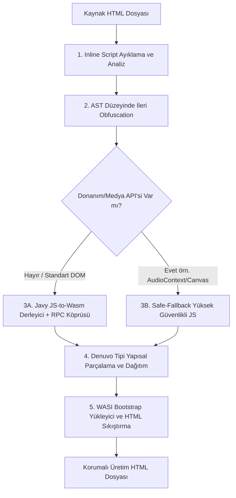

# 🛡️ Dontrea

[](https://opensource.org/licenses/MIT)
[](https://nodejs.org/)
[](https://github.com/Shopify/javy)
[](README.md)

> **[🇬🇧 Click here for English Documentation](README.md)**

**Dontrea**, web tabanlı uygulamalarınızı, oyunlarınızı ve JavaScript kaynak kodlarınızı tersine mühendisliğe (reverse engineering) ve korsanlığa (piracy) karşı korumak için geliştirilmiş, **Denuvo mimarisinden ilham alan** kurumsal düzeyde bir kod sanallaştırma, WebAssembly derleme ve anti-tamper otomasyon aracıdır.

---

## 📑 İçindekiler

- [Çekirdek Mimari](#-çekirdek-mimari)
- [Çalışma Anatomisi](#-çalışma-anatomisi)
- [Neden Javy WebAssembly?](#-neden-javy-webassembly)
- [Akıllı Çift Modlu Çalışma Motoru](#-akıllı-çift-modlu-çalışma-motoru)
- [Gereksinimler ve Kurulum](#-gereksinimler-ve-kurulum)
- [Kullanım ve Parametre Tablosu](#-kullanım-ve-parametre-tablosu)
- [Örnek Senaryolar](#-örnek-senaryolar)
- [Güvenlik Katmanları İncelemesi](#-güvenlik-katmanları-incelemesi)
- [Sıkça Sorulan Sorular (SSS)](#-sıkça-sorulan-sorular-sss)
- [Lisans](#-lisans)

---

## 🚀 Çekirdek Mimari

Dontrea, kaynak kodunuzu korumak için **5 katmanlı sarmal bir savunma mimarisi** kullanır:



1. **JS Ayıklama ve API Analizi:** Hedef HTML içerisindeki tüm satır içi `<script>` bloklarını ayıklar ve WebAssembly sandbox ortamı için uyumluluk analizinden geçirir.
2. **İleri Düzey Obfuscation:** JavaScript kodunu kontrol akışı düzleştirme (Control Flow Flattening), ölü kod enjeksiyonu, string dizisi şifreleme ve anti-devtools tuzaklarıyla anlamsal olarak tanınmaz hale getirir.
3. **JS-to-Wasm Derleme (Javy / QuickJS):** Karıştırılmış kodu Javy ile WebAssembly baytkoduna dönüştürür; DOM ve pencere manipülasyonları için çift yönlü senkronize RPC köprüsü sağlar.
4. **Denuvo Tipi Kod Dağıtımı:** Üretilen şifreli verileri belirlenen sayıda parçaya böler ve HTML içindeki rastgele üretilmiş `id` ve `data-*` niteliklerine sahip gizli elementlerin (`div`, `span`, `p`, vb.) içerisine serpiştirir.
5. **Runtime WASI Bootstrap ve HTML Minification:** Kodları çalışma zamanında birleştiren hafif `wasi_snapshot_preview1` bootstrap yükleyicisini ekledikten sonra tüm HTML dosyasını minify ederek tek satırlık aşırı karmaşık bir yapıya dönüştürür.

---

## 💡 Neden Javy WebAssembly?

Daha önce kullanılan deneysel derleyicilerin (örneğin Porffor) aksine Dontrea, **[Shopify Javy](https://github.com/Shopify/javy)** (Fabrice Bellard'ın **QuickJS** motoru) altyapısını kullanır:

| Özellik | Deneysel AOT Derleyiciler | Javy (QuickJS Motoru) |
| :--- | :--- | :--- |
| **Platform Desteği** | Yalnızca Linux / macOS / WSL | **Çapraz Platform: Windows, macOS, Linux** |
| **Dil Desteği** | Kısıtlı alt küme | **Eksiksiz ECMAScript 2020+ (Classes, Proxies, Async/Await, BigInt)** |
| **Kararlılık** | Prototip aşamasında | **Üretim Düzeyinde (Shopify Çekirdek Altyapısı)** |
| **DOM / Window Köprüsü** | Hatalı / Eksik | **Senkronize Çift Yönlü RPC Köprüsü** |
| **İzolasyon** | İlkel bellek | **Tam İzolasyonlu Wasm Sanal Makinesi** |

---

## ⚡ Akıllı Çift Modlu Çalışma Motoru

WebAssembly, işletim sisteminin doğrudan ses kartına veya GPU çizim kuyruklarına fiziksel erişimi olmayan izole bir doğrusal bellek (linear memory) havuzunda çalışır. Dontrea bu durumu **otomatik tespit mekanizması** ile çözer:

### 1. WebAssembly Modu (Hesaplama ve Standart DOM Mantığı İçin)
- JavaScript mantığınızı doğrudan WebAssembly baytkoduna derler.
- Standart konsol çıktıları (`console.log`, `console.error`) ve yüksek hassasiyetli zamanlayıcılar (`performance.now`) için gömülü bir WASI çalışma zamanı kullanır.
- Şeffaf köprü mekanizması sayesinde Wasm içerisinden `document.getElementById`, `.innerHTML`, `.style.*`, `.setAttribute` gibi DOM işlemleri sorunsuz yürütülür.

### 2. Safe-Fallback Modu (Yoğun Canvas ve Ses Uygulamaları İçin)
- Betik içerisinde doğrudan donanıma bağlı tarayıcı API'leri (`AudioContext`, `webkitAudioContext`, `canvas.getContext('2d')`, `WebGLRenderingContext`) tespit edildiğinde Dontrea otomatik olarak Safe-Fallback moduna geçer.
- Bu modda Web Audio yapıcı hataları engellenir; kod 60 FPS akıcılığında ve ses desteğiyle çalışırken maksimum obfuscation, anti-tamper tuzakları ve Denuvo parça dağıtımı eksiksiz uygulanır.
- İstenirse `--force-wasm true` parametresiyle Wasm derlemesi zorlanabilir.

---

## 📦 Gereksinimler ve Kurulum

### Gereksinimler
- **Node.js**: v18.0.0 veya üzeri
- **Javy CLI** (Wasm derlemesi için önerilir):
  ```bash
  npm install -g @shopify/javy-cli
  ```
  *Alternatif olarak [Shopify Javy Releases](https://github.com/Shopify/javy/releases) adresinden ikili dosyayı indirip `PATH` ortam değişkeninize ekleyebilirsiniz.*

### Kurulum

Projeyi klonlayın ve bağımlılıkları yükleyin:

```bash
git clone https://github.com/yaso09/dontrea.git
cd dontrea
npm install

# Komut satırında 'dontrea' komutunu global olarak kullanmak için:
npm link
```

---

## 🛠️ Kullanım ve Parametre Tablosu

### Temel Kullanım

```bash
dontrea -i index.html -o dist/protected.html
```

### Proje Yapılandırması ile Toplu Derleme

Proje kökünde `dontrea.json` oluşturun. Her `files` girdisi bir HTML kaynağını, çıktı dizinini ve bu dosyaya özel parametreleri tanımlar. `output` verilmezse çıktı adı kaynak dosyanın adı olur.

```json
{
  "files": [
    {
      "input": "src/index.html",
      "outputDir": "dist",
      "parts": 8,
      "noWasm": true,
      "selfDefending": true
    },
    {
      "input": "src/game.html",
      "outputDir": "dist/game",
      "options": {
        "parts": 12,
        "controlFlowFlattening": true,
        "controlFlowFlatteningThreshold": 1,
        "deadCodeInjection": true,
        "domainLock": ["example.com"]
      }
    }
  ]
}
```

Yapılandırma dosyasının bulunduğu dizinden:

```bash
dontrea build
```

Başka bir yapılandırma dosyası `dontrea build -c config/dontrea.json` ile seçilebilir. `input`, `output` ve `outputDir` yolları yapılandırma dosyasına göre çözülür. `outputDir` varsayılanı `dist` olur.

Derleme parametrelerini tüm HTML dosyaları için ortak varsayılan olarak eklemek veya güncellemek için `config add` kullanın:

```bash
dontrea config add --parts 8 --no-wasm --self-defending true
```

Bu komut değerleri `dontrea.json` içindeki `options` alanına yazar. Dosya bazındaki `options` veya parametreler ortak değerleri geçersiz kılar. Farklı bir yapılandırma yolu `dontrea config add -c config/dontrea.json --parts 8` biçiminde verilebilir.

Belirli bir HTML girdisini ve çıktı yolunu güncellemek için `-i` ve isteğe bağlı `-o` kullanın. Bu durumda yalnızca eşleşen dosyanın yapılandırması değişir:

```bash
dontrea config add -i src/game.html -o dist/game-protected.html --parts 12 --self-defending true
```

`-o` parametresi, hangi girdiye ait olduğunu belirlemek için `-i` ile birlikte kullanılmalıdır.

### Tüm Parametre Listesi

| Parametre | Kısa Yol | Varsayılan | Açıklama |
| :--- | :---: | :---: | :--- |
| `--input <path>` | `-i` | *Zorunlu* | Korunacak kaynak HTML dosyasının yolu. |
| `--output <path>` | `-o` | `protected.html` | Üretilecek korumalı HTML dosyasının yolu. |
| `--parts <number>` | `-p` | `5` | Kodun HTML içine kaç parçaya bölünerek dağıtılacağı. |
| `--control-flow-flattening <boolean>` | - | `false` | Kod akışını karmaşık durum makinelerine (state machine) dönüştürür. |
| `--control-flow-flattening-threshold <n>`| - | `0.75` | Akış düzleştirme uygulanma olasılık oranı (0.0 - 1.0). |
| `--dead-code-injection <boolean>` | - | `false` | Kodun arasına sahte ve çalışmayan kod blokları serpiştirir. |
| `--debug-protection <boolean>` | - | `false` | F12 / Geliştirici araçları açıldığında tarayıcı sekmesini dondurur. |
| `--debug-protection-interval <ms>` | - | `2000` | Anti-DevTools bütünlük tarama aralığı (milisaniye cinsinden). |
| `--self-defending <boolean>` | - | `false` | Kodun biçimlendirilmesini (beautify) engeller; formatlanırsa çöker. |
| `--domain-lock <domains...>` | - | - | Kodun sadece belirtilen alan adlarında çalışmasını kilitler (örn: `site.com`). |
| `--force-wasm <boolean>` | - | `false` | Donanım/Medya API'leri bulunsa bile Wasm derlemesini zorlar. |
| `--no-wasm` | - | `false` | Wasm derlemesini atlar, doğrudan Safe-Fallback JS modunu kullanır. |
| `--dynamic` | - | `false` | Daha küçük modüller üretmek için Javy'nin dinamik sağlayıcı (`-d`) bayrağını açar. |
| `--wasm-binary <path>` | - | - | Önceden derlenmiş özel `.wasm` dosyasını doğrudan HTML içine gömer. |

---

## 🚀 Örnek Senaryolar

### 1. Standart Web Uygulaması Koruması
```bash
dontrea -i myapp.html -o index.html -p 8
```

### 2. Maksimum Güvenlikli Ticari Oyun / Lisans Koruma Modu
```bash
dontrea -i game.html -o protected_game.html -p 12 \
  --control-flow-flattening true \
  --control-flow-flattening-threshold 1.0 \
  --dead-code-injection true \
  --debug-protection true \
  --debug-protection-interval 1000 \
  --self-defending true \
  --domain-lock sitem.com www.sitem.com
```

### 3. Saf JavaScript Safe-Fallback Modu
```bash
dontrea -i index.html -o protected.html --no-wasm --self-defending true
```

---

## 🔒 Güvenlik Katmanları İncelemesi

### 1. Denuvo Tipi Veri Serpiştirme
JavaScript kodunu tersine mühendislerin bellek dökümü (memory dump) alabileceği sıradan bir `<script>` etiketi içinde saklamak yerine Dontrea, Base64 verisini $N$ parçaya böler. Her bir parça rastgele üretilmiş kimliklerle görünmez HTML elementlerine gizlenir:

```html
<section id="dontrea-_0x7c49e2" data-node-_0x3a81f0="..." class="dontrea-hidden" aria-hidden="true"></section>
<aside id="dontrea-_0x1b28d4" data-node-_0xe72091="..." class="dontrea-hidden" aria-hidden="true"></aside>
```

Bu etiketler agresif CSS kurallarıyla (`opacity: 0`, `pointer-events: none`, `z-index: -9999`) tamamen gizlenir.

### 2. Anti-DevTools Koruması
`--debug-protection true` seçeneği aktif edildiğinde zamanlayıcı tabanlı anti-debugger döngüsü başlatılır. Bir kullanıcı F12 Geliştirici Araçlarını açtığında veya bellek manipülasyonu yapmaya çalıştığında kod sonsuz özyinelemeli bir döngüye girerek inceleme yapılmasını engeller.

### 3. Kendini Savunan Yapı (Self-Defending)
`--self-defending true` seçeneğinde bootstrap yükleyici kendi kaynak kodunun düzenini doğrular. Eğer kod bir güzelleştiriciden (beautifier/formatter) geçirilirse veya koda müdahale edilirse beyaz boşluk (whitespace) değişiklikleri tespit edilir ve kod kasıtlı bellek aşımıyla (stack overflow) çalışmayı durdurur.

---

## ❓ Sıkça Sorulan Sorular (SSS)

**S: Dontrea Canvas tabanlı tarayıcı oyunlarını koruyabilir mi?**  
C: Evet! Dontrea, `AudioContext` veya Canvas çizim context'lerini tespit ettiğinde otomatik olarak Safe-Fallback modunu devreye sokar. Bu sayede 60 FPS performans, ses sentezi ve oyun akışı korunurken Denuvo parça dağıtımı ve maksimum obfuscation eksiksiz uygulanır.

**S: Sistemimde Javy kurulu değilse ne olur?**  
C: Dontrea, `javy` aracının sisteminizde olup olmadığını kontrol eder. Bulunamazsa bir bildirim mesajı gösterir ve derlemeyi durdurmadan güvenle Safe-Fallback moduna geçiş yapar.

**S: Dontrea'nın çalışması için sunucu (backend) gerekir mi?**  
C: Hayır. Dontrea çıktısı, herhangi bir harici bağımlılık veya arka uç gerektirmeyen, doğrudan tüm modern tarayıcılarda (Chrome, Firefox, Safari, Edge) çalışan tek ve bağımsız bir `.html` dosyasıdır.

---

## 📄 Lisans

Bu proje [MIT Lisansı](LICENSE) kapsamında lisanslanmıştır.
