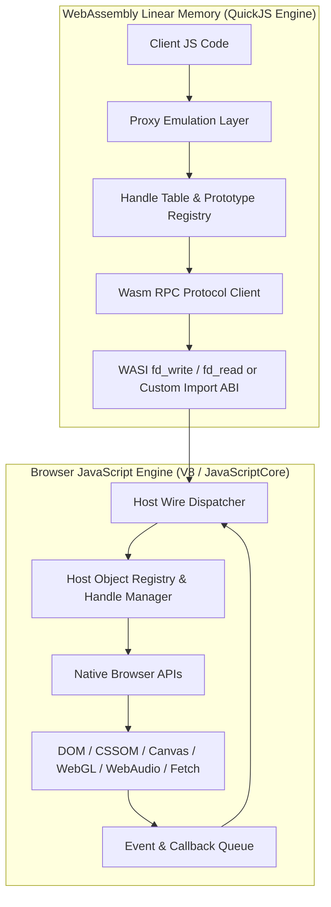

# 🏛️ Dontrea Universal Web Proxy Engine (UWPE) - Master Architecture

## 1. Executive Summary

This document defines the overarching architectural specification for enabling JavaScript code compiled into **WebAssembly (via Javy / QuickJS)** to access, manipulate, and execute **100% of all Browser & Web APIs** exposed to standard client-side JavaScript.

Because WebAssembly operates within a sandboxed, isolated linear memory space (`ArrayBuffer`), it possesses no direct pointers or references to the browser's Garbage Collection (GC) heap, Document Object Model (DOM), audio hardware, or GPU pipelines. 

To bridge this fundamental divide and allow protected, Wasm-compiled JavaScript to run real-world web applications, games, and UI frameworks without modification, Dontrea introduces the **Universal Web Proxy Engine (UWPE)**.

---

## 2. Core Architectural Pillars



### Pillar I: Handle-Based Object Lifetime & Identity Management
No complex host object (such as a `HTMLCanvasElement`, `AudioContext`, `WebGLTexture`, or `EventTarget`) can be cloned into WebAssembly linear memory. Instead, all host objects are represented by **integer handles (`HandleID`)**.

- **Host Side:** An `ObjectRegistry` maintains two collections:
  - `handleToObject: Map<number, Object>`: Maps integer IDs to real browser DOM/API objects.
  - `objectToHandle: WeakMap<Object, number>`: Enables identity preservation (`el1 === el2` remains true across Wasm calls).
  - `finalizerRegistry: FinalizationRegistry`: Detects when a proxy inside Wasm has been garbage collected by QuickJS and issues a `FREE_HANDLE` command to avoid memory leaks on the host.
- **Wasm Side:** A lightweight object descriptor:
  ```typescript
  interface WasmHandleProxy {
      __handle__: number;
      __type__: string;
      __proto_id__: number;
  }
  ```

### Pillar II: Transparent Recursive ES6 Proxy Virtualization
Every handle inside WebAssembly is wrapped in a dynamic ECMAScript `Proxy`. This proxy traps:
1. **`get(target, prop, receiver)`:**
   - Detects special symbols (`Symbol.iterator`, `Symbol.toPrimitive`, `Symbol.hasInstance`).
   - If `prop` is a method, returns an invokable bridge function.
   - If `prop` is an object property, queries the host and returns a wrapped proxy or primitive.
2. **`set(target, prop, value, receiver)`:**
   - Serializes primitive or unwraps argument handles and issues a `SET_PROP` command.
3. **`apply(target, thisArg, argumentsList)`:**
   - Invokes methods on the host with properly bound `this` references.
4. **`construct(target, argumentsList, newTarget)`:**
   - Traps the `new` operator (e.g., `new AudioContext()`, `new Image()`, `new FormData()`), calls the host constructor, registers the created object in `ObjectRegistry`, and returns its new Wasm handle proxy.
5. **`has(target, prop)`:** Traps the `in` operator (`'localStorage' in window`).
6. **`deleteProperty(target, prop)`:** Traps `delete obj.prop`.

### Pillar III: High-Performance Binary & Buffer Bridge (Zero-Copy)
Graphic APIs (Canvas 2D, WebGL, WebGPU) and Audio APIs require transferring millions of bytes (e.g., `ImageData`, vertex buffers, audio PCM Float32 data) per second.
- Wasm linear memory is directly accessible to the host via `instance.exports.memory.buffer`.
- Bridge commands transfer memory slices using pointer offsets and lengths:
  ```javascript
  // Fast path for TypedArray upload to WebGL / Canvas:
  hostBuffer.set(new Uint8Array(wasmMemory.buffer, ptr, len));
  ```
- Sub-millisecond direct views bypass JSON serialization entirely.

### Pillar IV: Synchronous & Asynchronous Event & Callback Dispatching
1. **Host-to-Wasm Event Callbacks:**
   - When `element.addEventListener(type, listener)` is called in Wasm, the listener function is registered in Wasm's `CallbackRegistry` with a unique `callbackId`.
   - The host registers a native callback that intercepts the event, creates a handle for the `Event` object, and queues execution for Wasm.
2. **Wasm Asynchronous Event Loop Integration:**
   - Microtasks and Macrotasks (`setTimeout`, `requestAnimationFrame`, `Promise`) trigger synchronized turns of QuickJS's job queue (`JS_ExecutePendingJob`).

### Pillar V: Prototype Chain & `instanceof` Emulation
Web applications frequently verify object types via `instanceof`:
```javascript
if (event.target instanceof HTMLInputElement) { ... }
if (node instanceof DocumentFragment) { ... }
```
To achieve 100% compliance:
- For every native browser constructor function exposed in Wasm, `Symbol.hasInstance` is implemented:
  ```javascript
  Constructor[Symbol.hasInstance] = function(instance) {
      if (!instance || typeof instance !== 'object' || !instance.__handle__) return false;
      return __uwpe_check_instanceof(instance.__handle__, constructorName);
  };
  ```

---

## 3. Communication Protocol Specification

The bridge communication protocol operates over an ABI layer (`wasi_snapshot_preview1` or custom imported WebAssembly functions).

### Message Frame Encoding
Messages between Wasm and the Host are encoded either in structured binary headers or optimized micro-JSON frames:

| Field | Type | Description |
| :--- | :--- | :--- |
| `cmd` | `uint8` | Operation opcode (`GET`, `SET`, `CALL`, `NEW`, `LISTEN`, `DISPATCH`, `FREE`) |
| `targetHandle` | `uint32` | Handle ID of the target object (`0` for `window` / global scope) |
| `prop` | `string` | Property name, method name, or symbol identifier |
| `args` | `Array` | Serialized arguments (primitives as values, objects as `{"$h": handleId}`) |
| `retType` | `uint8` | Expected return type hint (`PRIMITIVE`, `HANDLE`, `VOID`, `PROMISE`) |

### Standard Opcodes
- `0x01` - `CMD_GET_GLOBAL`: Retrieve global handle (`window`, `document`, `navigator`).
- `0x02` - `CMD_GET_PROP`: Read property from handle.
- `0x03` - `CMD_SET_PROP`: Write property to handle.
- `0x04` - `CMD_CALL_METHOD`: Call method on handle with arguments.
- `0x05` - `CMD_CONSTRUCT`: Instantiate constructor (`new Class(...)`).
- `0x06` - `CMD_ADD_EVENT_LISTENER`: Register event listener on handle.
- `0x07` - `CMD_REMOVE_EVENT_LISTENER`: Deregister event listener.
- `0x08` - `CMD_DISPATCH_CALLBACK`: Invoke Wasm callback from host.
- `0x09` - `CMD_BUFFER_SYNC`: Bulk synchronize typed memory buffer.
- `0x0A` - `CMD_RELEASE_HANDLE`: Decrement reference count / free handle.

---

## 4. Master Task Inventory (Classification of All Browser APIs)

The implementation planning is partitioned into 10 comprehensive task specifications in the `tasks/` directory:

| Document | Subsystem / API Category | Core Interfaces Covered |
| :--- | :--- | :--- |
| **`01_DOM_CORE_AND_EVENTS.md`** | DOM Tree & Event Subsystem | `Node`, `Element`, `Document`, `EventTarget`, `Event`, `MouseEvent`, `KeyboardEvent`, `PointerEvent`, etc. |
| **`02_HTML5_ELEMENTS_AND_FORMS.md`** | HTML Elements, Forms & Media | `HTMLElement`, `HTMLInputElement`, `HTMLMediaElement`, `FormData`, `File`, `Blob`, etc. |
| **`03_CSSOM_AND_STYLING.md`** | CSSOM, Geometry & Viewport | `CSSStyleDeclaration`, `CSSRule`, `getComputedStyle`, `DOMRect`, `matchMedia`, Scroll APIs. |
| **`04_WINDOW_BOM_AND_NAVIGATION.md`** | Window, Navigation & Timers | `Window`, `Location`, `History`, `Navigator`, `Performance`, `requestAnimationFrame`, Timers. |
| **`05_CANVAS_2D_AND_IMAGE_APIS.md`** | Canvas 2D & Imaging | `HTMLCanvasElement`, `CanvasRenderingContext2D`, `ImageData`, `Path2D`, `OffscreenCanvas`. |
| **`06_WEBGL_AND_WEBGPU.md`** | 3D Graphics & GPU Compute | `WebGLRenderingContext`, `WebGL2RenderingContext`, `WebGPU`, shaders, buffers, textures. |
| **`07_WEB_AUDIO_API.md`** | Web Audio API | `AudioContext`, `AudioNode`, `AudioBufferSourceNode`, `GainNode`, `BiquadFilterNode`, etc. |
| **`08_NETWORK_FETCH_AND_COMMUNICATION.md`**| Network & Real-time I/O | `fetch`, `Request`, `Response`, `Headers`, `XMLHttpRequest`, `WebSocket`, `WebRTC`. |
| **`09_STORAGE_AND_INDEXEDDB.md`** | Client-Side Storage | `localStorage`, `sessionStorage`, `IndexedDB` (`IDBDatabase`, `IDBTransaction`), `CacheStorage`. |
| **`10_WORKERS_STREAMS_AND_SYSTEM_APIS.md`**| Multithreading & Modern APIs | `Worker`, `SubtleCrypto`, `IntersectionObserver`, `MutationObserver`, `ReadableStream`, Geolocation. |

---

## 5. Verification & Testing Strategy
Every subsystem task must pass 5 testing stages:
1. **Interface Surface Reflection Test:** All properties, prototype methods, and constants match native browser objects.
2. **Read/Write State Mutation Test:** Property assignments persist and mutate the actual DOM / host state.
3. **Execution Round-Trip Test:** Complex multi-step scenarios (e.g. creating elements, styling them, appending to body, playing synthesized audio, drawing to canvas).
4. **Performance Benchmark:** Less than 0.05ms overhead per simple bridge invocation; zero-copy for buffer operations above 64KB.
5. **Memory Leak Audit:** Zero handle leaks in `ObjectRegistry` after 100,000 DOM node creations and garbage collection passes.
