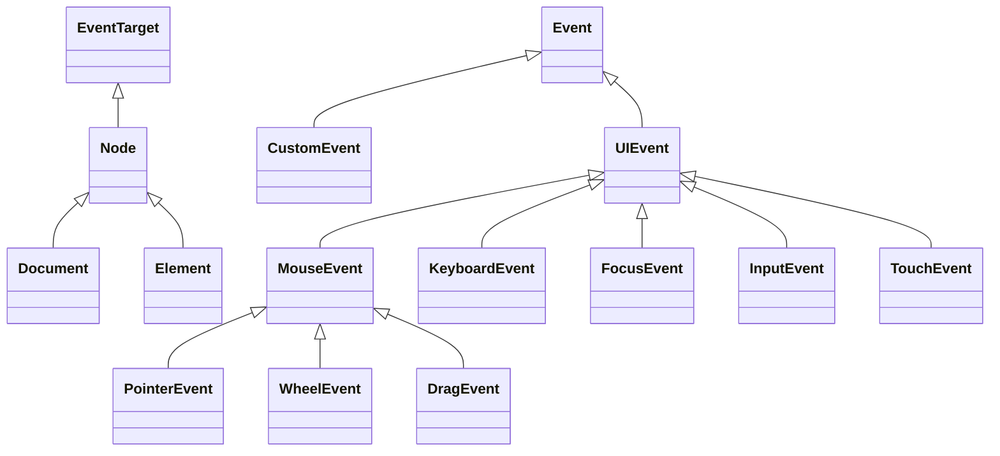

# 📋 Task 01: DOM Core, Nodes, Traversal & Event Subsystem

## 1. Scope & Objective
Enable Wasm-compiled JavaScript to access and execute 100% of the Document Object Model (DOM Level 1, 2, 3, 4 and DOM Living Standard), including all node types, collections, structural mutation methods, range selections, tree traversals, and the unified Event system (dispatching, propagation, listener management).

---

## 2. API Surface & Interface Inventory

### 2.1 Interface: `EventTarget`
The root interface implemented by `Node`, `Element`, `Document`, `Window`, `XMLHttpRequest`, etc.
- **Methods:**
  - `addEventListener(type: string, callback: EventListenerOrEventListenerObject | null, options?: AddEventListenerOptions | boolean): void`
  - `removeEventListener(type: string, callback: EventListenerOrEventListenerObject | null, options?: EventListenerOptions | boolean): void`
  - `dispatchEvent(event: Event): boolean`
- **Wasm Implementation Details:**
  - Wasm functions passed as callbacks are wrapped in a `WasmCallbackProxy` and assigned a `callbackId`.
  - Host stores `callbackId -> nativeWrapper` map on the target handle.
  - When the event triggers, the host packages the `Event` handle and queues execution in the Wasm QuickJS event loop.

---

### 2.2 Interface: `Node`
Inherits from `EventTarget`. Base class for all DOM entities.
- **Constants (Node Types):**
  - `ELEMENT_NODE = 1`
  - `ATTRIBUTE_NODE = 2`
  - `TEXT_NODE = 3`
  - `CDATA_SECTION_NODE = 4`
  - `ENTITY_REFERENCE_NODE = 5`
  - `ENTITY_NODE = 6`
  - `PROCESSING_INSTRUCTION_NODE = 7`
  - `COMMENT_NODE = 8`
  - `DOCUMENT_NODE = 9`
  - `DOCUMENT_TYPE_NODE = 10`
  - `DOCUMENT_FRAGMENT_NODE = 11`
  - `NOTATION_NODE = 12`
- **Constants (Document Positions):**
  - `DOCUMENT_POSITION_DISCONNECTED = 0x01`
  - `DOCUMENT_POSITION_PRECEDING = 0x02`
  - `DOCUMENT_POSITION_FOLLOWING = 0x04`
  - `DOCUMENT_POSITION_CONTAINS = 0x08`
  - `DOCUMENT_POSITION_CONTAINED_BY = 0x10`
  - `DOCUMENT_POSITION_IMPLEMENTATION_SPECIFIC = 0x20`
- **Properties (Read-Only & Mutable):**
  - `nodeType: number`
  - `nodeName: string`
  - `baseURI: string`
  - `isConnected: boolean`
  - `ownerDocument: Document | null`
  - `parentNode: Node | null`
  - `parentElement: Element | null`
  - `childNodes: NodeList`
  - `firstChild: Node | null`
  - `lastChild: Node | null`
  - `previousSibling: Node | null`
  - `nextSibling: Node | null`
  - `nodeValue: string | null` (Getter & Setter)
  - `textContent: string | null` (Getter & Setter)
- **Methods:**
  - `hasChildNodes(): boolean`
  - `getRootNode(options?: GetRootNodeOptions): Node`
  - `insertBefore<T extends Node>(node: T, child: Node | null): T`
  - `appendChild<T extends Node>(node: T): T`
  - `replaceChild<T extends Node>(node: Node, child: T): T`
  - `removeChild<T extends Node>(child: T): T`
  - `normalize(): void`
  - `cloneNode(deep?: boolean): Node`
  - `isEqualNode(otherNode: Node | null): boolean`
  - `isSameNode(otherNode: Node | null): boolean`
  - `compareDocumentPosition(other: Node): number`
  - `contains(other: Node | null): boolean`
  - `lookupPrefix(namespace: string | null): string | null`
  - `lookupNamespaceURI(prefix: string | null): string | null`
  - `isDefaultNamespace(namespace: string | null): boolean`

---

### 2.3 Interface: `Document`
Inherits from `Node`. Represents the entire web page.
- **Properties:**
  - `documentElement: HTMLElement`
  - `head: HTMLHeadElement`
  - `body: HTMLElement`
  - `title: string` (Getter & Setter)
  - `characterSet: string`
  - `contentType: string`
  - `doctype: DocumentType | null`
  - `URL: string`
  - `documentURI: string`
  - `compatMode: string`
  - `cookie: string` (Getter & Setter)
  - `lastModified: string`
  - `readyState: DocumentReadyState` ("loading" | "interactive" | "complete")
  - `referrer: string`
  - `designMode: string` ("on" | "off")
  - `activeElement: Element | null`
  - `visibilityState: DocumentVisibilityState` ("visible" | "hidden")
  - `hidden: boolean`
  - `defaultView: (WindowProxy & typeof globalThis) | null`
  - `forms: HTMLCollectionOf<HTMLFormElement>`
  - `images: HTMLCollectionOf<HTMLImageElement>`
  - `links: HTMLCollectionOf<HTMLAnchorElement | HTMLAreaElement>`
  - `scripts: HTMLCollectionOf<HTMLScriptElement>`
- **Methods:**
  - `getElementById(elementId: string): HTMLElement | null`
  - `getElementsByClassName(classNames: string): HTMLCollectionOf<Element>`
  - `getElementsByTagName(qualifiedName: string): HTMLCollectionOf<Element>`
  - `getElementsByTagNameNS(namespace: string | null, localName: string): HTMLCollectionOf<Element>`
  - `querySelector<E extends Element = Element>(selectors: string): E | null`
  - `querySelectorAll<E extends Element = Element>(selectors: string): NodeListOf<E>`
  - `createElement<K extends keyof HTMLElementTagNameMap>(tagName: K, options?: ElementCreationOptions): HTMLElementTagNameMap[K]`
  - `createElementNS(namespaceURI: string | null, qualifiedName: string, options?: ElementCreationOptions): Element`
  - `createTextNode(data: string): Text`
  - `createDocumentFragment(): DocumentFragment`
  - `createComment(data: string): Comment`
  - `createCDATASection(data: string): CDATASection`
  - `createProcessingInstruction(target: string, data: string): ProcessingInstruction`
  - `createAttribute(localName: string): Attr`
  - `createAttributeNS(namespace: string | null, qualifiedName: string): Attr`
  - `importNode<T extends Node>(node: T, deep?: boolean): T`
  - `adoptNode<T extends Node>(node: T): T`
  - `createRange(): Range`
  - `createNodeIterator(root: Node, whatToShow?: number, filter?: NodeFilter | null): NodeIterator`
  - `createTreeWalker(root: Node, whatToShow?: number, filter?: NodeFilter | null): TreeWalker`
  - `createEvent(eventInterface: string): Event`
  - `hasFocus(): boolean`
  - `execCommand(commandId: string, showUI?: boolean, value?: string): boolean`

---

### 2.4 Interface: `Element`
Inherits from `Node`. Represents any element tag.
- **Properties:**
  - `tagName: string`, `localName: string`, `prefix: string | null`, `namespaceURI: string | null`
  - `id: string`, `className: string`, `classList: DOMTokenList`
  - `attributes: NamedNodeMap`
  - `innerHTML: string`, `outerHTML: string` (Full reactive Setter & Getter)
  - `shadowRoot: ShadowRoot | null`, `slot: string`, `part: DOMTokenList`
  - `children: HTMLCollection`, `firstElementChild: Element | null`, `lastElementChild: Element | null`
  - `childElementCount: number`, `previousElementSibling: Element | null`, `nextElementSibling: Element | null`
- **Methods:**
  - `getAttribute(qualifiedName: string): string | null`
  - `getAttributeNS(namespace: string | null, localName: string): string | null`
  - `setAttribute(qualifiedName: string, value: string): void`
  - `setAttributeNS(namespace: string | null, qualifiedName: string, value: string): void`
  - `removeAttribute(qualifiedName: string): void`
  - `removeAttributeNS(namespace: string | null, localName: string): void`
  - `hasAttribute(qualifiedName: string): boolean`
  - `hasAttributeNS(namespace: string | null, localName: string): boolean`
  - `hasAttributes(): boolean`
  - `getAttributeNames(): string[]`
  - `getAttributeNode(qualifiedName: string): Attr | null`
  - `setAttributeNode(attr: Attr): Attr | null`
  - `removeAttributeNode(attr: Attr): Attr`
  - `closest<E extends Element = Element>(selectors: string): E | null`
  - `matches(selectors: string): boolean`
  - `attachShadow(init: ShadowRootInit): ShadowRoot`
  - `insertAdjacentElement(where: InsertPosition, element: Element): Element | null`
  - `insertAdjacentText(where: InsertPosition, data: string): void`
  - `insertAdjacentHTML(position: InsertPosition, text: string): void`
  - `append(...nodes: (Node | string)[]): void`
  - `prepend(...nodes: (Node | string)[]): void`
  - `before(...nodes: (Node | string)[]): void`
  - `after(...nodes: (Node | string)[]): void`
  - `replaceWith(...nodes: (Node | string)[]): void`
  - `remove(): void`
  - `toggleAttribute(qualifiedName: string, force?: boolean): boolean`
  - `checkVisibility(options?: CheckVisibilityOptions): boolean`
  - `requestFullscreen(options?: FullscreenOptions): Promise<void>`
  - `setPointerCapture(pointerId: number): void`
  - `releasePointerCapture(pointerId: number): void`
  - `hasPointerCapture(pointerId: number): boolean`

---

### 2.5 Collections & Auxiliary Interfaces
- **`DOMTokenList` (e.g. `element.classList`):**
  - Properties: `length: number`, `value: string`
  - Methods: `item(index: number): string | null`, `contains(token: string): boolean`, `add(...tokens: string[]): void`, `remove(...tokens: string[]): void`, `toggle(token: string, force?: boolean): boolean`, `replace(token: string, newToken: string): boolean`, `supports(token: string): boolean`, `values()`, `keys()`, `entries()`, `forEach(callback: (value: string, key: number, parent: DOMTokenList) => void)`.
- **`NamedNodeMap` (`element.attributes`):**
  - `length: number`, `item(index: number): Attr | null`, `getNamedItem(qualifiedName: string): Attr | null`, `setNamedItem(attr: Attr): Attr | null`, `removeNamedItem(qualifiedName: string): Attr`.
- **`NodeList` & `HTMLCollection`:**
  - Array-like indexing (`list[0]`), `length`, `item()`, `forEach()`, `entries()`, `keys()`, `values()`.
- **`Range` & `Selection`:**
  - Properties: `startContainer`, `startOffset`, `endContainer`, `endOffset`, `collapsed`, `commonAncestorContainer`.
  - Methods: `setStart()`, `setEnd()`, `collapse()`, `selectNode()`, `selectNodeContents()`, `deleteContents()`, `extractContents()`, `cloneContents()`, `insertNode()`, `surroundContents()`, `cloneRange()`, `detach()`.

---

### 2.6 The Event Subsystem Hierarchy

Every event dispatched in the browser must be constructed or captured in Wasm with full property and method parity:



#### Base: `Event`
- **Constants:** `NONE = 0`, `CAPTURING_PHASE = 1`, `AT_TARGET = 2`, `BUBBLING_PHASE = 3`
- **Properties:**
  - `type: string`, `target: EventTarget | null`, `currentTarget: EventTarget | null`
  - `eventPhase: number`, `bubbles: boolean`, `cancelable: boolean`, `defaultPrevented: boolean`
  - `composed: boolean`, `isTrusted: boolean`, `timeStamp: DOMHighResTimeStamp`
- **Methods:**
  - `stopPropagation(): void`, `stopImmediatePropagation(): void`, `preventDefault(): void`, `composedPath(): EventTarget[]`

#### Specialized Event Classes
1. **`CustomEvent`:** Adds `detail: any`.
2. **`UIEvent`:** Adds `view: WindowProxy | null`, `detail: number`.
3. **`MouseEvent`:** Adds `screenX, screenY, clientX, clientY, ctrlKey, shiftKey, altKey, metaKey, button, buttons, relatedTarget, movementX, movementY, offsetX, offsetY, pageX, pageY`.
4. **`KeyboardEvent`:** Adds `key: string, code: string, location: number, ctrlKey: boolean, shiftKey: boolean, altKey: boolean, metaKey: boolean, repeat: boolean, isComposing: boolean, getModifierState(keyArg: string): boolean`.
5. **`PointerEvent`:** Adds `pointerId: number, width: number, height: number, pressure: number, tangentialPressure: number, tiltX: number, tiltY: number, twist: number, pointerType: string, isPrimary: boolean`.
6. **`TouchEvent`:** Adds `touches: TouchList, targetTouches: TouchList, changedTouches: TouchList, altKey, metaKey, ctrlKey, shiftKey`.
7. **`WheelEvent`:** Adds `deltaX: number, deltaY: number, deltaZ: number, deltaMode: number (DOM_DELTA_PIXEL=0, DOM_DELTA_LINE=1, DOM_DELTA_PAGE=2)`.
8. **`FocusEvent`:** Adds `relatedTarget: EventTarget | null`.
9. **`InputEvent`:** Adds `data: string | null, isComposing: boolean, inputType: string, dataTransfer: DataTransfer | null`.
10. **`SubmitEvent`:** Adds `submitter: HTMLElement | null`.

---

## 3. Implementation Blueprint for Wasm Proxy Layer

1. **Proxy Generator Template:**
   ```javascript
   function createNodeProxy(handleId, typeName) {
       return new Proxy({ __handle__: handleId, __type__: typeName }, {
           get(target, prop) {
               if (prop === 'childNodes') return createNodeListProxy(target.__handle__);
               if (prop === 'classList') return createDOMTokenListProxy(target.__handle__);
               if (prop === 'style') return createCSSStyleProxy(target.__handle__);
               // Check method table or dispatch property read
               return __uwpe_read_prop(target.__handle__, prop);
           },
           set(target, prop, val) {
               return __uwpe_write_prop(target.__handle__, prop, val);
           }
       });
   }
   ```
2. **Event Dispatch Loop:**
   - Host event listener intercepts DOM event, queries `objectToHandle` for `event.target`, assigns handle for `event`, and calls `instance.exports.__uwpe_dispatch_event(callbackId, eventHandle)`.
