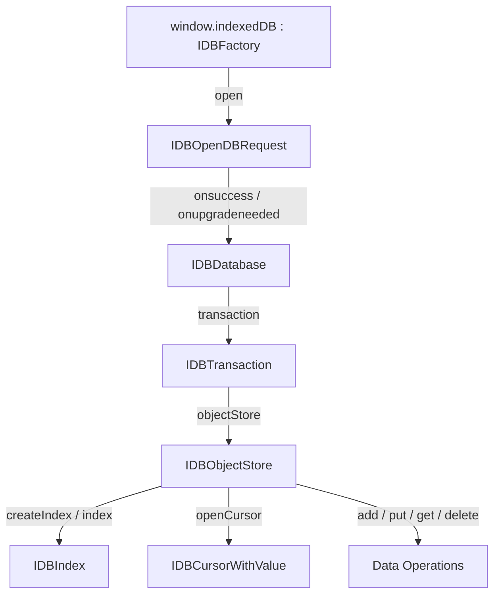

# 📋 Task 09: Storage, IndexedDB, Cache API & Client-Side Persistence Subsystem

## 1. Scope & Objective
Provide full fidelity for client-side persistence mechanisms in Wasm-compiled JavaScript: synchronous Web Storage (`localStorage`, `sessionStorage`), the complete `IndexedDB` transactional object store database ecosystem (`IDBFactory`, `IDBDatabase`, `IDBTransaction`, `IDBObjectStore`, `IDBCursor`, `IDBIndex`, `IDBKeyRange`), the offline `CacheStorage` / `Cache` API, and modern `CookieStore`.

---

## 2. API Surface & Interface Inventory

### 2.1 Interface: `Storage` (`localStorage` & `sessionStorage`)
Accessible via `window.localStorage` and `window.sessionStorage`.
- **Properties:**
  - `length: number`
- **Methods:**
  - `getItem(key: string): string | null`
  - `setItem(key: string, value: string): void`
  - `removeItem(key: string): void`
  - `clear(): void`
  - `key(index: number): string | null`
- **Dynamic Property Traps:**
  - Direct bracket and dot notation access (`localStorage.myKey = 'value'`, `const val = localStorage['myKey']`, `delete localStorage.myKey`) are intercepted by the proxy and forwarded to `setItem` / `getItem` / `removeItem`.
- **Events: `StorageEvent`**
  - Dispatched on `window`: `key: string | null`, `oldValue: string | null`, `newValue: string | null`, `url: string`, `storageArea: Storage | null`.

---

### 2.2 Comprehensive `IndexedDB` Subsystem

#### 1. `IDBFactory` (`window.indexedDB`)
- **Methods:**
  - `open(name: string, version?: number): IDBOpenDBRequest`
  - `deleteDatabase(name: string): IDBOpenDBRequest`
  - `databases(): Promise<IDBDatabaseInfo[]>`
  - `cmp(first: any, second: any): number` (-1, 0, 1)

#### 2. `IDBDatabase`
Inherits from `EventTarget`.
- **Properties:**
  - `name: string`, `version: number`, `objectStoreNames: DOMStringList`
- **Methods:**
  - `createObjectStore(name: string, optionalParameters?: IDBObjectStoreParameters): IDBObjectStore`
  - `deleteObjectStore(name: string): void`
  - `transaction(storeNames: string | string[], mode?: IDBTransactionMode, options?: IDBTransactionOptions): IDBTransaction`
  - `close(): void`
- **Event Handlers:** `onabort`, `onclose`, `onerror`, `onversionchange`.

#### 3. `IDBTransaction`
- **Properties:**
  - `db: IDBDatabase`, `mode: IDBTransactionMode` ("readonly" | "readwrite" | "versionchange")
  - `objectStoreNames: DOMStringList`, `error: DOMException | null`, `durability: IDBTransactionDurability` ("default" | "strict" | "relaxed")
- **Methods:**
  - `objectStore(name: string): IDBObjectStore`
  - `commit(): void`, `abort(): void`
- **Events:** `oncomplete`, `onerror`, `onabort`.

#### 4. `IDBObjectStore`
- **Properties:**
  - `name: string`, `keyPath: string | string[] | null`, `indexNames: DOMStringList`
  - `transaction: IDBTransaction`, `autoIncrement: boolean`
- **CRUD Operations:**
  - `add(value: any, key?: IDBValidKey): IDBRequest<IDBValidKey>`
  - `put(value: any, key?: IDBValidKey): IDBRequest<IDBValidKey>`
  - `get(query: IDBValidKey | IDBKeyRange): IDBRequest<any>`
  - `getAll(query?: IDBValidKey | IDBKeyRange | null, count?: number): IDBRequest<any[]>`
  - `getKey(query: IDBValidKey | IDBKeyRange): IDBRequest<IDBValidKey | undefined>`
  - `getAllKeys(query?: IDBValidKey | IDBKeyRange | null, count?: number): IDBRequest<IDBValidKey[]>`
  - `delete(query: IDBValidKey | IDBKeyRange): IDBRequest<undefined>`
  - `clear(): IDBRequest<undefined>`
  - `count(query?: IDBValidKey | IDBKeyRange): IDBRequest<number>`
- **Index & Cursor Factory:**
  - `createIndex(name: string, keyPath: string | string[], options?: IDBIndexParameters): IDBIndex`
  - `index(name: string): IDBIndex`, `deleteIndex(name: string): void`
  - `openCursor(query?: IDBValidKey | IDBKeyRange | null, direction?: IDBCursorDirection): IDBRequest<IDBCursorWithValue | null>`
  - `openKeyCursor(query?: IDBValidKey | IDBKeyRange | null, direction?: IDBCursorDirection): IDBRequest<IDBCursor | null>`

#### 5. `IDBIndex`
- `name: string`, `objectStore: IDBObjectStore`, `keyPath: string | string[]`, `multiEntry: boolean`, `unique: boolean`
- `get()`, `getAll()`, `getKey()`, `getAllKeys()`, `count()`, `openCursor()`, `openKeyCursor()`.

#### 6. `IDBCursor` & `IDBCursorWithValue`
- **Properties:** `source: IDBObjectStore | IDBIndex`, `direction: IDBCursorDirection`, `key: IDBValidKey`, `primaryKey: IDBValidKey`, `value: any`
- **Navigation & Mutations:**
  - `advance(count: number): void`
  - `continue(key?: IDBValidKey): void`
  - `continuePrimaryKey(key: IDBValidKey, primaryKey: IDBValidKey): void`
  - `update(value: any): IDBRequest<IDBValidKey>`
  - `delete(): IDBRequest<undefined>`

#### 7. `IDBKeyRange`
Constructor & Static Utilities:
- `IDBKeyRange.only(value: any): IDBKeyRange`
- `IDBKeyRange.lowerBound(lower: any, open?: boolean): IDBKeyRange`
- `IDBKeyRange.upperBound(upper: any, open?: boolean): IDBKeyRange`
- `IDBKeyRange.bound(lower: any, upper: any, lowerOpen?: boolean, upperOpen?: boolean): IDBKeyRange`
- `lower: any`, `upper: any`, `lowerOpen: boolean`, `upperOpen: boolean`, `includes(key: any): boolean`.

#### 8. `IDBRequest` & `IDBOpenDBRequest`
- `result: any`, `error: DOMException | null`, `source: any`, `transaction: IDBTransaction | null`, `readyState: IDBRequestReadyState` ("pending" | "done")
- Event handlers: `onsuccess`, `onerror`, `onblocked`, `onupgradeneeded`.

---

### 2.3 Service Worker Cache API (`CacheStorage` & `Cache`)
Accessible via `window.caches`.
- **`CacheStorage`:**
  - `open(cacheName: string): Promise<Cache>`
  - `has(cacheName: string): Promise<boolean>`
  - `delete(cacheName: string): Promise<boolean>`
  - `keys(): Promise<string[]>`
  - `match(request: RequestInfo | URL, options?: MultiCacheQueryOptions): Promise<Response | undefined>`
- **`Cache`:**
  - `match(request: RequestInfo | URL, options?: CacheQueryOptions): Promise<Response | undefined>`
  - `matchAll(request?: RequestInfo | URL, options?: CacheQueryOptions): Promise<readonly Response[]>`
  - `add(request: RequestInfo | URL): Promise<void>`
  - `addAll(requests: readonly (RequestInfo | URL)[]): Promise<void>`
  - `put(request: RequestInfo | URL, response: Response): Promise<void>`
  - `delete(request: RequestInfo | URL, options?: CacheQueryOptions): Promise<boolean>`
  - `keys(request?: RequestInfo | URL, options?: CacheQueryOptions): Promise<readonly Request[]>`

---

### 2.4 Asynchronous Cookie Store API: `cookieStore`
- `cookieStore.get(name?: string | CookieStoreGetOptions): Promise<CookieListItem | null>`
- `cookieStore.getAll(name?: string | CookieStoreGetOptions): Promise<CookieListItem[]>`
- `cookieStore.set(name: string, value: string): Promise<void>`
- `cookieStore.set(options: CookieInit): Promise<void>`
- `cookieStore.delete(name: string | CookieStoreDeleteOptions): Promise<void>`
- `onchange: ((this: CookieStore, ev: CookieChangeEvent) => any) | null`

---

## 3. Implementation Plan for Wasm Runtime
1. **Asynchronous IndexedDB Request Bridge:**
   - In IndexedDB, operations return an `IDBRequest` immediately and trigger `onsuccess`/`onerror` when complete.
   - Wasm creates an `IDBRequestProxy`. Host hooks native `onsuccess`/`onerror` and triggers Wasm callback dispatchers when transactions commit or retrieve records.
2. **Synchronous `localStorage` / `sessionStorage` Cache Layer:**
   - To avoid micro-round trips for repeated reads, a read-through in-memory Map caches storage keys inside Wasm and invalidates on write.
