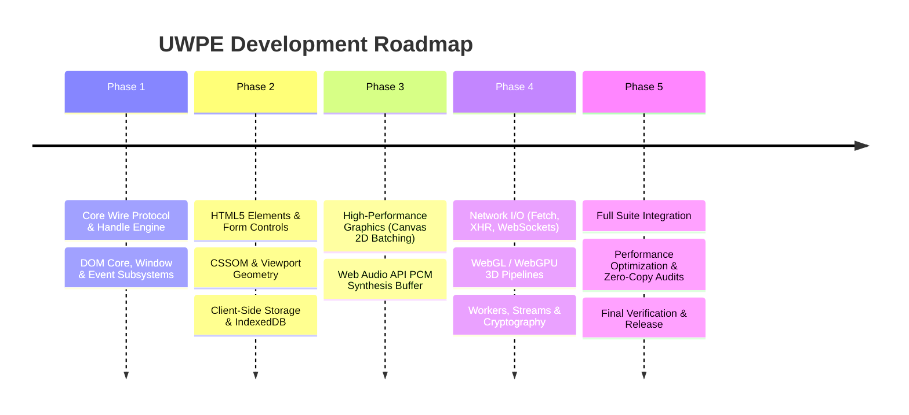

# 🗺️ Dontrea Universal Web Proxy Engine (UWPE) - Implementation Roadmap

This directory contains the exhaustive specifications for enabling JavaScript code compiled into **WebAssembly** to seamlessly access, manipulate, and execute **100% of all Browser & Web APIs** exposed to standard client-side JavaScript.

---

## 📑 Specification Index

| Task File | Subsystem / API Domain | Key Interfaces & Features Covered |
| :--- | :--- | :--- |
| [**`00_MASTER_ARCHITECTURE.md`**](00_MASTER_ARCHITECTURE.md) | **Master Architecture & UWPE Core** | Object handle table, binary wire protocol, recursive ES6 proxy engine, zero-copy buffer bridge, callback dispatching, prototype & `instanceof` emulation. |
| [**`01_DOM_CORE_AND_EVENTS.md`**](01_DOM_CORE_AND_EVENTS.md) | **DOM Core, Nodes & Events** | `Node`, `Element`, `Document`, `DocumentFragment`, `EventTarget`, `Event`, `MouseEvent`, `KeyboardEvent`, `PointerEvent`, `TouchEvent`, tree mutation & traversal. |
| [**`02_HTML5_ELEMENTS_AND_FORMS.md`**](02_HTML5_ELEMENTS_AND_FORMS.md) | **HTML5 Elements, Forms & Media** | `HTMLElement`, `HTMLInputElement`, `HTMLFormElement`, `FormData`, `HTMLMediaElement`, `HTMLAudioElement`, `HTMLVideoElement`, `HTMLImageElement`, `File`, `Blob`, `FileReader`. |
| [**`03_CSSOM_AND_STYLING.md`**](03_CSSOM_AND_STYLING.md) | **CSSOM, Geometry & Viewport** | `CSSStyleDeclaration`, `window.getComputedStyle`, `CSSStyleSheet`, `getBoundingClientRect`, `DOMRect`, `DOMPoint`, scroll geometry, Web Animations API. |
| [**`04_WINDOW_BOM_AND_NAVIGATION.md`**](04_WINDOW_BOM_AND_NAVIGATION.md) | **Window, BOM & Performance** | `Window` globals, `Location`, `History`, `Navigator`, `Screen`, `setTimeout`, `setInterval`, `requestAnimationFrame`, `URL`, `URLSearchParams`, `performance.now()`. |
| [**`05_CANVAS_2D_AND_IMAGE_APIS.md`**](05_CANVAS_2D_AND_IMAGE_APIS.md) | **Canvas 2D & Pixel Manipulation** | `HTMLCanvasElement`, `CanvasRenderingContext2D`, `OffscreenCanvas`, `ImageData`, `Path2D`, 60 FPS command batching buffer, direct memory mapping. |
| [**`06_WEBGL_AND_WEBGPU.md`**](06_WEBGL_AND_WEBGPU.md) | **3D Graphics & GPU Compute** | `WebGLRenderingContext` (WebGL 1), `WebGL2RenderingContext` (WebGL 2), `WebGPU` (`GPUDevice`, `GPUQueue`), shaders, vertex buffers, textures, framebuffers. |
| [**`07_WEB_AUDIO_API.md`**](07_WEB_AUDIO_API.md) | **Web Audio API & Sound Synthesis** | `AudioContext`, `OfflineAudioContext`, `AudioNode`, `AudioParam`, `AudioBufferSourceNode`, `GainNode`, `BiquadFilterNode`, `OscillatorNode`, procedural audio, PCM buffers. |
| [**`08_NETWORK_FETCH_AND_COMMUNICATION.md`**](08_NETWORK_FETCH_AND_COMMUNICATION.md) | **Network I/O & Real-Time Comms** | `fetch()`, `Request`, `Response`, `Headers`, `AbortController`, `XMLHttpRequest`, `WebSocket`, `EventSource`, `BroadcastChannel`, `WebRTC` (`RTCPeerConnection`). |
| [**`09_STORAGE_AND_INDEXEDDB.md`**](09_STORAGE_AND_INDEXEDDB.md) | **Storage & Client-Side Databases** | `localStorage`, `sessionStorage`, full `IndexedDB` hierarchy (`IDBDatabase`, `IDBTransaction`, `IDBObjectStore`, `IDBCursor`, `IDBIndex`), `CacheStorage`, `CookieStore`. |
| [**`10_WORKERS_STREAMS_AND_SYSTEM_APIS.md`**](10_WORKERS_STREAMS_AND_SYSTEM_APIS.md) | **Workers, Streams & System APIs** | `Worker`, `MessageChannel`, `ReadableStream`, `WritableStream`, `crypto.subtle`, `getRandomValues`, `MutationObserver`, `IntersectionObserver`, `ResizeObserver`, Geolocation. |

---

## 🎯 Implementation Phases

### Phase 1: Core Virtualization Infrastructure
- Implement the `ObjectRegistry` handle manager on the host (`WeakMap` + integer ID pool).
- Implement the recursive ES6 Proxy trap engine inside Wasm (`get`, `set`, `apply`, `construct`, `has`, `deleteProperty`).
- Implement the bi-directional event dispatcher loop for `addEventListener` and callback routing.
- Deliver **Task 01 (DOM Core & Events)** and **Task 04 (Window & BOM)**.

### Phase 2: Structural DOM, CSSOM & Persistence
- Implement full `HTMLElement` properties, `dataset` proxying, and form validation bindings.
- Implement `element.style` batching and `getComputedStyle` read-only proxies.
- Deliver **Task 02 (HTML5 Elements & Forms)**, **Task 03 (CSSOM & Styling)**, and **Task 09 (Storage & IndexedDB)**.

### Phase 3: High-Throughput Media & Graphics
- Implement the Canvas 2D command batching buffer in Wasm linear memory.
- Implement the zero-copy buffer bridge for `AudioBuffer.getChannelData` and `ImageData.data`.
- Deliver **Task 05 (Canvas 2D & Imaging)** and **Task 07 (Web Audio API)**.

### Phase 4: Networking, 3D Graphics & Modern Systems
- Implement asynchronous Promise settling for `fetch()`, `Blob.arrayBuffer()`, and `crypto.subtle`.
- Implement binary buffer uploads for WebGL `bufferData` and WebGPU queues.
- Implement Observer callbacks (`IntersectionObserver`, `MutationObserver`).
- Deliver **Task 06 (WebGL & WebGPU)**, **Task 08 (Network I/O)**, and **Task 10 (Workers, Streams & Systems)**.

### Phase 5: Production Hardening & Benchmarking
- Memory leak stress tests (100,000 DOM allocations / deletions).
- Zero-copy verification for all buffers >= 64KB.
- Seamless compatibility testing against popular web frameworks (React, Vue, Svelte) and game engines (Three.js, Phaser, PixiJS).
